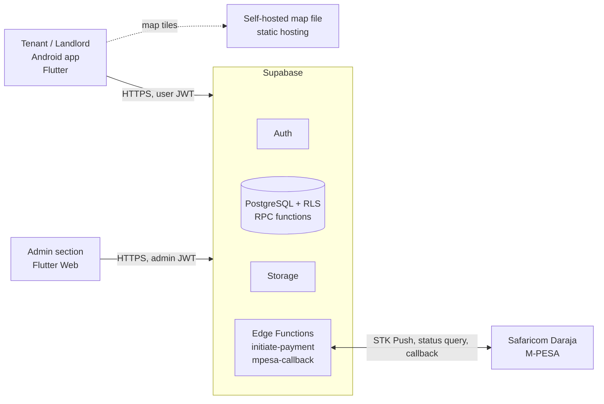

# NyumbaLink: System Architecture

**Version:** 0.2 (DRAFT PROPOSAL, pending founder approval)
**Derived from:** Constitution Art. 4, 6, 8, 9, 16; SOFTWARE_REQUIREMENTS v0.3; ARCHITECTURAL_DECISIONS
**Implementation status:** Nothing here is built. This is the intended design.

## 1. Components



| Component | Technology | Notes |
|---|---|---|
| Mobile app | Flutter, Dart (Android first) | Tenant and landlord experience. No admin code, no secrets. |
| Admin section | Flutter Web, same repository, separate entry point | **Approved for the Phase 1 prototype** (ADR-002, D14); hosting pending (Q10). Separate login. |
| Backend | Supabase: Auth, PostgreSQL, Storage, Edge Functions | Approved stack (Art. 4). Edge Functions are the only server-side code, and they exist because M-PESA secrets and callbacks cannot live in the app. |
| Payments | Safaricom Daraja M-PESA Express (STK Push) | Pending business setup (Q5). Sandbox first. |
| Maps | See section 6 | Free option selected. |

All access control lives in Postgres RLS and RPC functions, so a modified client cannot gain access (Art. 8.3).

## 2. Layers (Art. 6.1)

1. **Presentation:** screens and widgets, no data access.
2. **State:** screen state and user actions. I recommend Riverpod for testability, as a dependency needing approval.
3. **Repository:** the only layer that knows how data is fetched. Features depend on interfaces, so tests run without a live backend.
4. **Services:** Supabase client wrapper, location, image compression and blurring, map.

## 3. Repository layout (adapts Art. 6.2)

```
nyumbalink/
├── lib/
│   ├── main.dart                 # tenant + landlord app entry
│   ├── core/                     # constants, errors, theme, utils, shared widgets, services
│   ├── features/
│   │   ├── authentication/       # role choice, sign up, sign in, recovery
│   │   ├── properties/           # listing create/edit/delete, details, landlord dashboard
│   │   ├── search/
│   │   ├── payments/             # fee display, payment flow, history
│   │   ├── favourites/
│   │   ├── reports/
│   │   └── notifications/
│   └── shared/                   # models, repositories
├── lib/admin/                    # admin features; imported ONLY by main_admin.dart
├── lib/main_admin.dart
├── supabase/
│   ├── migrations/
│   └── functions/                # initiate-payment, mpesa-callback
├── docs/
└── test/
```

This differs from Art. 6.2 (no `enquiries`; `payments` and `reports` added; admin moved out of `features/`) and needs a recorded amendment.

## 4. Payment flow

```mermaid
sequenceDiagram
  participant App as Tenant app
  participant EF as initiate-payment (Edge Function)
  participant DB as Postgres
  participant MP as M-PESA (Daraja)
  participant CB as mpesa-callback (Edge Function)
  App->>EF: listing id, confirmed phone (user JWT)
  EF->>DB: check email verified, listing approved, no open or paid attempt
  EF->>DB: fee_for_rent(price) -> amount; insert payment 'initiated'
  EF->>MP: STK Push (amount, phone, callback URL)
  MP-->>EF: CheckoutRequestID
  EF->>DB: status 'pending'
  MP->>App: PIN prompt on the phone
  MP->>CB: result callback
  CB->>MP: query status of CheckoutRequestID (do not trust the callback alone)
  CB->>DB: match checkout id, amount and phone; set 'paid' + receipt (idempotent)
  CB->>DB: notify landlord: contact unlocked
  App->>DB: poll or subscribe for status; on 'paid' call get_contact()
```

Design points:
- The amount comes from the server, never the app.
- M-PESA callbacks arrive from the public internet and carry no signature I know of. The callback handler therefore confirms the result with M-PESA's status query and matches checkout id, amount and number before marking a payment paid.
- Timeouts: a payment stuck in `pending` is checked by status query and moved to `timed_out`, `failed` or `paid`. A tenant who paid but lost connection still gets the unlock when the callback or query completes.
- Edge Function secrets (Daraja keys, passkey) are held in Supabase function secrets and never leave the server.
- Production Daraja access may require a fixed, whitelisted server IP according to developer guides. Edge Functions may not provide one. To confirm with Safaricom before building around it; if needed, the callback and payment calls move to a small fixed-IP service, which adds cost and is a new component needing approval.

## 5. Other key flows

**Sign-up.** First screen: Tenant or Landlord. Email and Kenyan phone number are collected. A verification email is sent, and the app waits for verification before listings or payments are allowed. A trigger creates `profiles` with the chosen role.

**Landlord creates a listing.** Form, then location permission, GPS position, movable pin, photos compressed with a blurred copy made on the device, upload, saved as `submitted`. It appears to tenants only after admin approval.

**Tenant browses.** Approved, non-deleted listings are loaded with blurred photos. Details and a Pay button show the fee from the server. After payment: full photos, exact pin on the map, landlord number and a call button (the call opens the phone dialler, outside the platform).

**Admin.** Review queue, reports, payments and refund requests, through RPC functions that write `moderation_log`.

## 6. Map choice (D10, delegated)

The condition is free. The app now charges tenants, so it is commercial, and that rules out several "free" options. What I checked:
- **OpenStreetMap's own public tile servers** forbid heavy use, naming distribution of an app that uses their tiles as an example, without permission. Not suitable.
- **MapTiler and Stadia Maps free plans** exclude commercial use. Not suitable for a revenue-earning app.
- **Google Maps** needs a billing-enabled project, which the constitution makes approval-gated.

**Selected: self-hosted OpenStreetMap data, shown with flutter_map and vector tiles.** A regional PMTiles file (a single map file, roughly 100 MB for a region according to a Protomaps tutorial) is cut from the free Protomaps world build for the Kitui area, placed on static hosting that supports byte-range requests, and read by the app through `vector_map_tiles_pmtiles` (MIT licence, available on pub.dev). There is no per-use fee and no API key. Cloudflare R2 is the host Protomaps recommends; I have not verified its current free allowance.

Required: show "© OpenStreetMap contributors" on the map. Packages to be reviewed under Art. 4.1: flutter_map, vector_map_tiles, vector_map_tiles_pmtiles, and a location package (such as geolocator). I verified the licence of only one of them.

**Fallback if you want the simplest possible start:** skip the in-app map. The landlord's phone GPS position is saved as the pin, and the tenant taps "Open in Maps" after paying to launch the maps app already on their phone. It costs nothing and has no map files or map dependencies. The cost is no pin-adjusting preview for landlords.

## 7. Security architecture (Art. 8)

- The app ships only the public Supabase URL and anon key. The service-role key and M-PESA secrets never appear in any client, including the admin section.
- Every table has RLS, and paid content is separated into protected tables, functions and storage paths (DATABASE_SCHEMA).
- Admin identity is a row in `admin_users` that no client can write. Admin accounts are dedicated and created manually. I recommend multi-factor authentication for them; availability and plan limits to be verified.
- Location permission is requested only when a landlord places a pin.
- RLS policies and payment logic are tested per role, with the M-PESA sandbox, before any live payment (Art. 14).

## 8. Resilience and cost (Art. 9.3, 16)

- Every call has loading, empty and error states with retry. The payment screen survives the app being closed or the connection dropping mid-payment.
- Images are compressed on the device, and thumbnails are used in lists.
- **Supabase free plan:** projects with low activity are paused after 7 days, and Supabase recommends a paid plan if people rely on the project. A paused backend would stop payments. A paid plan is likely needed before the pilot (Q11).
- Recurring costs to approve before use: Supabase paid plan, map file hosting, email delivery for verification, M-PESA transaction fees.
